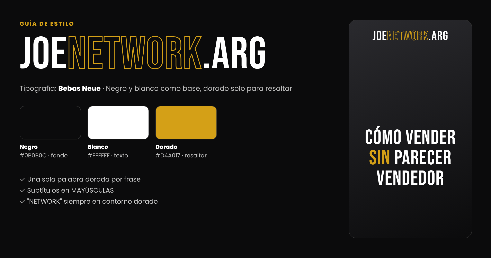

# Guía de estilo · joenetwork.arg

> ⚠️ **Guía anterior.** La identidad oficial vigente es la de [IDENTIDAD-VISUAL.md](IDENTIDAD-VISUAL.md) (negro + lima eléctrico).

Cuenta de negocios: comunicación, negocios, ventas, network marketing y productos.

## Tipografía

**Bebas Neue** (gratis, Google Fonts: https://fonts.google.com/specimen/Bebas+Neue).
Disponible también en Canva y CapCut.

## Logo

`JOE` + `NETWORK` + `.ARG`

- `JOE` y `.ARG`: blanco relleno.
- `NETWORK`: **solo contorno dorado** (sin relleno).

## Colores

| Color  | Código    | Uso                                   |
|--------|-----------|---------------------------------------|
| Negro  | `#0B0B0C` | Fondo                                 |
| Blanco | `#FFFFFF` | Texto principal                       |
| Dorado | `#D4A017` | Resaltar (logo y palabras clave)      |

La base es **negro y blanco**. El dorado es solo un toque: si se usa en todo, pierde fuerza.

## Subtítulos en videos

- Letra Bebas Neue, en **MAYÚSCULAS**, blanca.
- **Una sola palabra dorada por frase**: la palabra clave (ej.: "CÓMO VENDER **SIN** PARECER VENDEDOR").
- Opcional para palabras muy importantes: fondo dorado con letra negra.
- Formato vertical 9:16 (Reels / TikTok), logo arriba centrado.

## Relación con joellinares.arg

- **joellinares.arg** (personal): misma tipografía, solo blanco y negro.
- **joenetwork.arg** (negocios): blanco y negro + toque dorado.

Así las dos cuentas se ven "de la misma familia" y el dorado identifica la de negocios.

## Otras muestras que se evaluaron

- [Tipografías](estilo/muestra-tipografias.png)
- [Colores](estilo/muestra-colores.png)
- [Blanco y negro vs. dorado](estilo/negro-vs-dorado.png)
