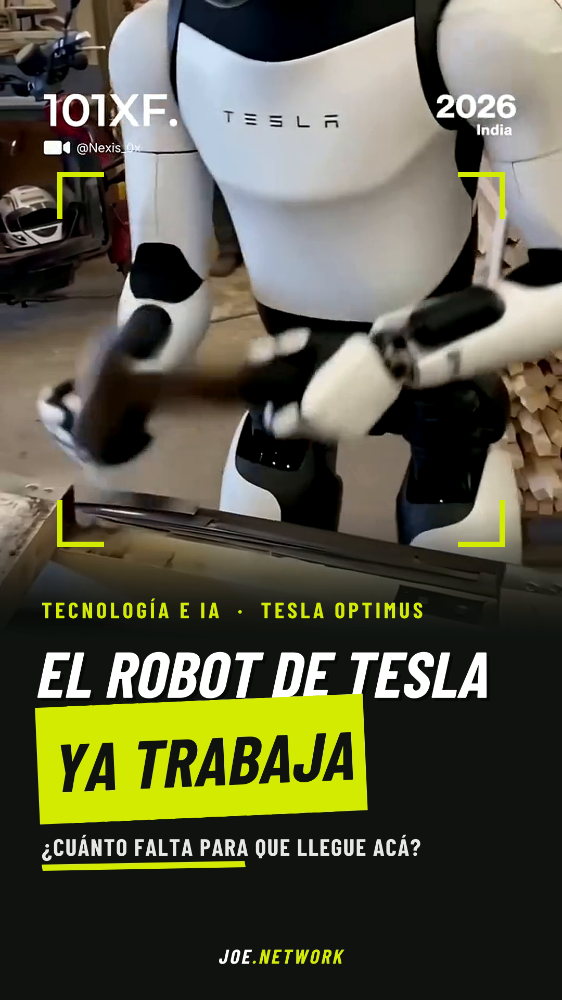

# Manual de identidad visual · JOE.NETWORK

> **Nombre de la cuenta: JOENETWORK.ARG** (no "JOE.NETWORK").
>
> **Identidad oficial vigente.** Reemplaza a la [guía anterior en negro y dorado](GUIA-DE-ESTILO.md).
> Se aplica a todas las portadas, carruseles, reels, flyers, miniaturas, publicaciones y piezas educativas,
> sin importar qué herramienta o inteligencia artificial las cree.

**JOE.NETWORK** · Tecnología · Negocios · Habilidades · Desarrollo personal
**Lema:** *El futuro no se espera, se construye.*

## 1. Identidad de marca

Temas: emprendimiento y negocios · inteligencia artificial y tecnología · desarrollo personal ·
inteligencia comercial · comunicación y liderazgo · educación financiera · desarrollo de habilidades ·
productos e innovación · futuro del trabajo.

Debe transmitir **evolución, movimiento, innovación, profesionalismo, energía y crecimiento**.
No debe parecer una marca corporativa tradicional ni una página genérica de frases motivacionales.

## 2. Paleta de colores

| Color | Código | Uso |
|---|---|---|
| **Lima eléctrico** | `#D4FF00` | Color distintivo: palabras clave y bloques destacados |
| Negro profundo | `#101410` | Fondos |
| Blanco puro | `#FFFFFF` | Texto principal |
| Verde oscuro | `#25351D` | Fondos secundarios, degradados |
| Gris claro | `#E8E8E8` | Texto secundario, detalles |

Distribución orientativa: **60 % negro / fondos oscuros · 25 % blanco y neutros · 15 % lima**.
No sumar otros colores saturados que compitan con la identidad.

> Para subtítulos ASS (libass) los colores se escriben en orden BGR:
> lima `&H0000FFD4&`, negro `&H00101410&`, verde oscuro `&H001D3525&`, gris `&H00E8E8E8&`.

## 3. Tipografía

Gruesa, condensada, contundente y en **mayúsculas**, con inclinación moderada para dar movimiento.

| Uso | Fuente |
|---|---|
| Títulos principales | **Barlow Condensed ExtraBold Italic** |
| Títulos alternativos / números | Anton · Archivo Black · Montserrat Black Italic |
| Textos secundarios | Barlow Condensed Bold / SemiBold |

Los archivos están en `editor/fonts/` (licencia libre OFL).

- Alto contraste y jerarquía clara: las palabras importantes, **mucho más grandes**.
- Texto **negro sobre bloques lima** o **blanco sobre fondo negro**.
- Evitar tipografías finas, cursivas decorativas, infantiles o demasiado futuristas.

## 4. Estilo gráfico

Estética editorial moderna + fotografía cinematográfica + diseño deportivo + comunicación tecnológica.
Recursos, cuando corresponda (no todos a la vez):

- Rectángulos lima **ligeramente inclinados**.
- Subrayados con efecto pincel y flechas dibujadas.
- Marcos de enfoque en las esquinas.
- Íconos minimalistas.
- Texturas de papel rasgado.
- Degradados oscuros, sombras y profundidad.
- Fotografías realistas de alto impacto.

## 5. Estilo fotográfico

Realismo, iluminación cinematográfica, alto contraste, fondos con profundidad de campo,
protagonistas claros y composiciones dinámicas.
Evitar fotos genéricas de stock, ilustraciones infantiles y efectos tecnológicos exagerados.
**Si una imagen hecha con IA representa una noticia real, no presentarla como foto documental auténtica.**

## 6. Portadas de reels

- 1080 × 1920 px (9:16).
- Titular corto: **4 a 10 palabras**. Que genere curiosidad sin contar todo.
- Legible desde el celular.
- Texto importante dentro de la **zona segura central** (en la cuadrícula del perfil Instagram muestra la franja central 1080 × 1440).
- Firma discreta **JOENETWORK.ARG** ("JOENETWORK" en blanco y ".ARG" en lima), con el crédito del video original al lado cuando corresponda: `JOENETWORK.ARG · Video: @cuenta`.

## 7. Carruseles educativos

- Primera diapositiva: curiosidad.
- Diapositivas del medio: contenido claro, con jerarquía, gráficos y ejemplos. Sin saturar.
- Última: reflexión o llamado a la acción.
- Misma identidad en todas.

## 8. Series

Cada serie puede tener una identidad secundaria, pero conserva colores y lenguaje gráfico.

**Serie 1: HABILIDADES PARA EL FUTURO**
Lema: *El futuro no se espera, se construye.*
Temas: comunicación, inteligencia emocional, liderazgo, creatividad, pensamiento crítico, mentalidad y adaptación.

## 9. Sensación

Moderno · profesional · potente · dinámico · inteligente · innovador · educativo · aspiracional · humano.
**Curiosidad y reflexión, no miedo ni sensacionalismo.**

## 10. Instrucción permanente

Cada pieza gráfica de JOE.NETWORK aplica este sistema automáticamente.
No copiar la composición de una portada anterior: reinterpretar los recursos para crear piezas nuevas
pero reconocibles. El objetivo es que alguien reconozca una publicación de JOE.NETWORK por sus colores,
tipografía y estilo **antes de leer el nombre de la cuenta**.

Ejemplos de titulares por tema:

| Tema | Titular |
|---|---|
| Tecnología e IA | ¿ESTAMOS PREPARADOS? |
| Negocios | VENDER NO ES CONVENCER |
| Desarrollo personal | SER INTELIGENTE NO ALCANZA |
| Comunicación | APRENDÉ A CONECTAR |

## 11. Subtítulos de videos de noticias (franja inferior) — estilo aprobado

Para videos de terceros con texto informativo (ej. drones que cosechan manzanas):

- **Altura:** a ~¾ del video (texto principal en y ≈ 1450 de 1920), sobre una **franja oscura difuminada** (#101410, ~70 % de opacidad en el centro, bordes suaves).
- **Línea 1 (español):** una sola línea corta, **lima #D4FF00**, Barlow Condensed ExtraBold Italic, mayúsculas.
- **Línea 2 (inglés):** blanco, Barlow Condensed SemiBold, más chica, debajo.
- **Línea 3:** firma y crédito chicos: `JOENETWORK.ARG · Video: @cuenta` (".ARG" en lima).
- Aparición suave (fundido + leve subida), sin animaciones bruscas.
- **Audio original** del video, normalizado a −14 LUFS para que se escuche bien en Instagram.
